# Skyward

English | [简体中文](README.zh-CN.md)

Skyward is a recovery written in Rust, from scratch.

> **MIX Flip 2 (`bixi`) · 1.0.1** — this branch builds Skyward for the Xiaomi MIX Flip 2
> (SM8750, Android 17, A/B + dynamic partitions, running `OS4.0.11.XOHCNXM`, built on
> `OS4.0.0.11.XOHCNXM`). The cover display is the
> primary screen, `/data` unlocks itself once the password has been kept, images can be
> kept on a USB stick, `avbctl` flags are written with their before/after difference
> reported back, and the recovery updates itself from GitHub releases — bare `.img`
> first, `.zip` after it — through a mirror you pick.
> Full changelog, what was borrowed from other forks and the known limits:
> [CHANGELOG-bixi.md](CHANGELOG-bixi.md) · [Releases](https://github.com/XQAB/skyward/releases)
> How the port got here, decision by decision: [docs/bixi-porting.md](docs/bixi-porting.md)

<p align="center">
  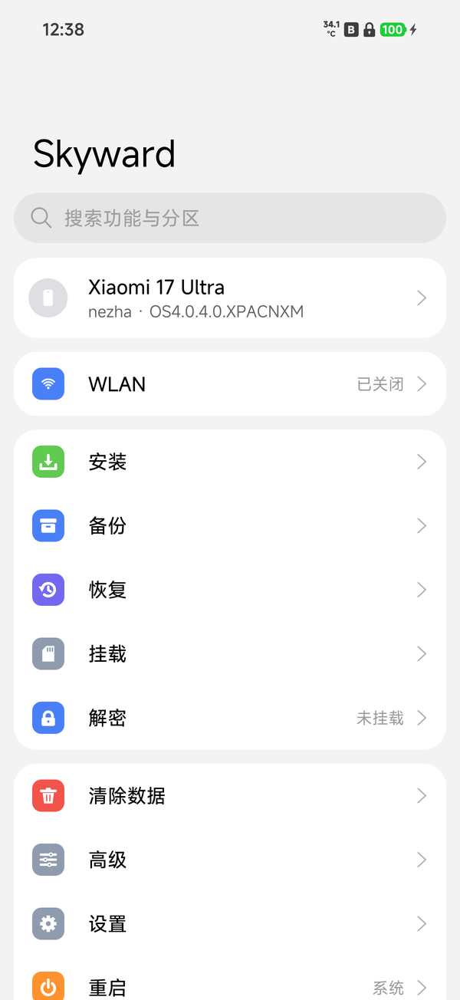
  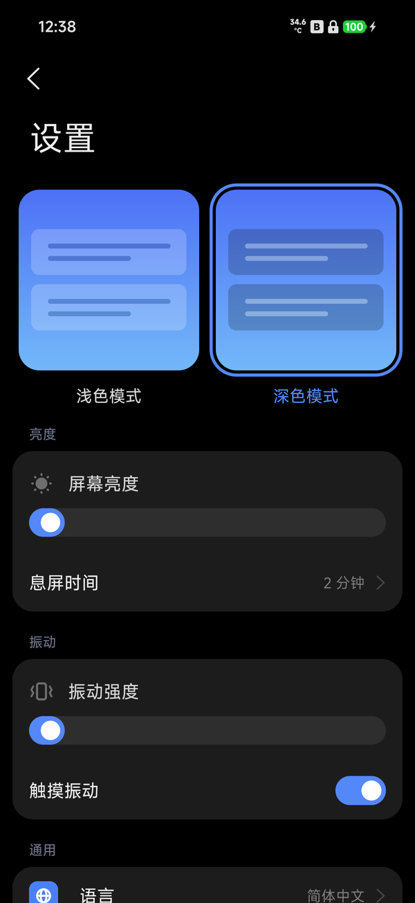
  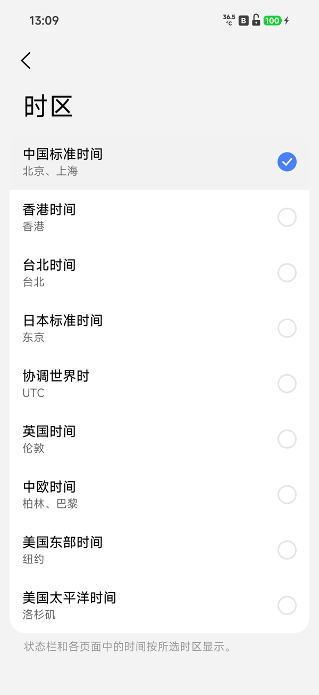
</p>

## Features

### Dual boot

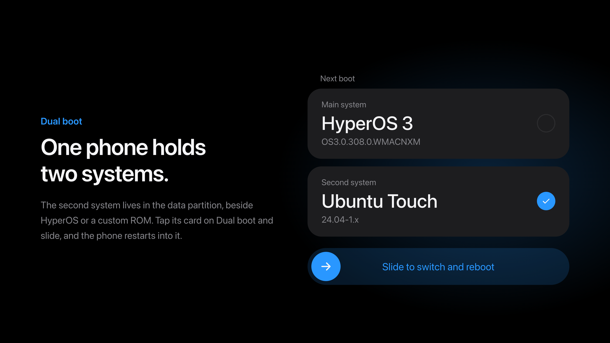

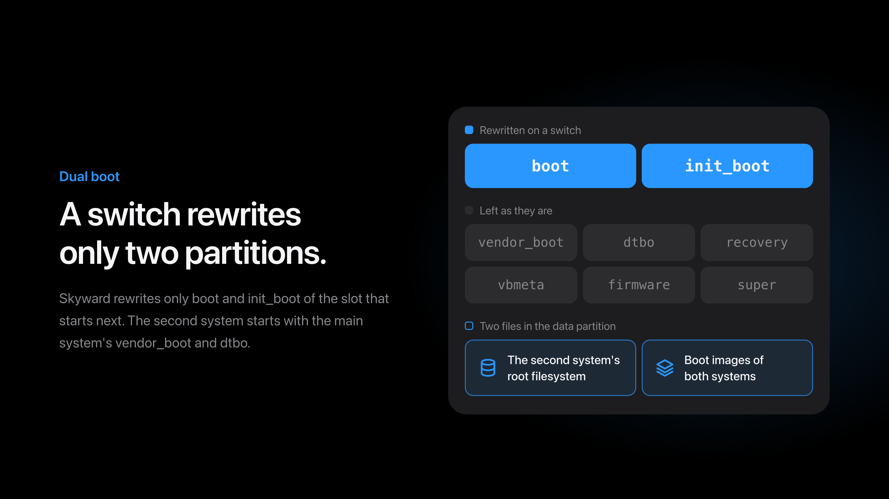

How a second system is packaged and started is in
[How dual boot works](#how-dual-boot-works).

### Decryption

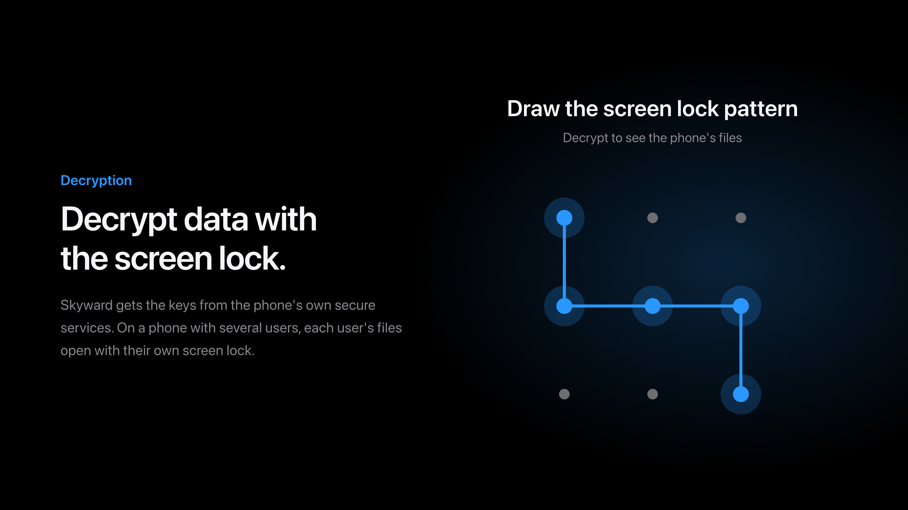

### Installing

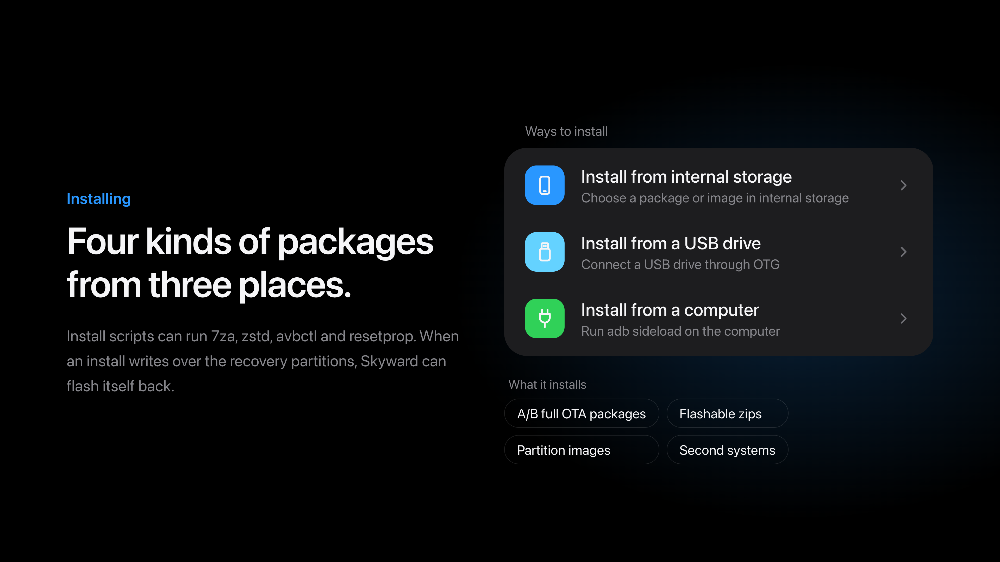

Install scripts get `7za` and `zstd`, which ROMs with a super image compressed by
zstd use to flash it, and an `unzip` whose `-p` streams the image as it reads it.
They also get `avbctl` and `resetprop`, to turn off verified boot's checks and to
read and set properties.

### Online updates

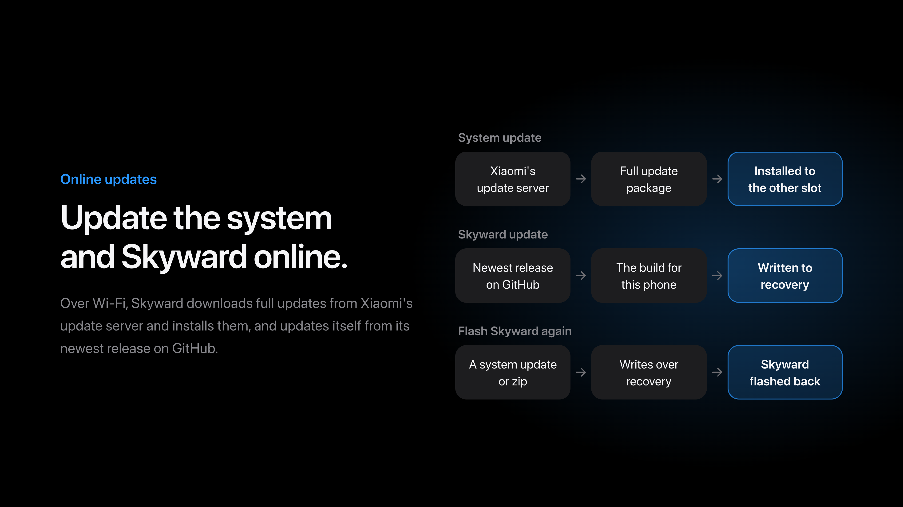

### Backup and restore

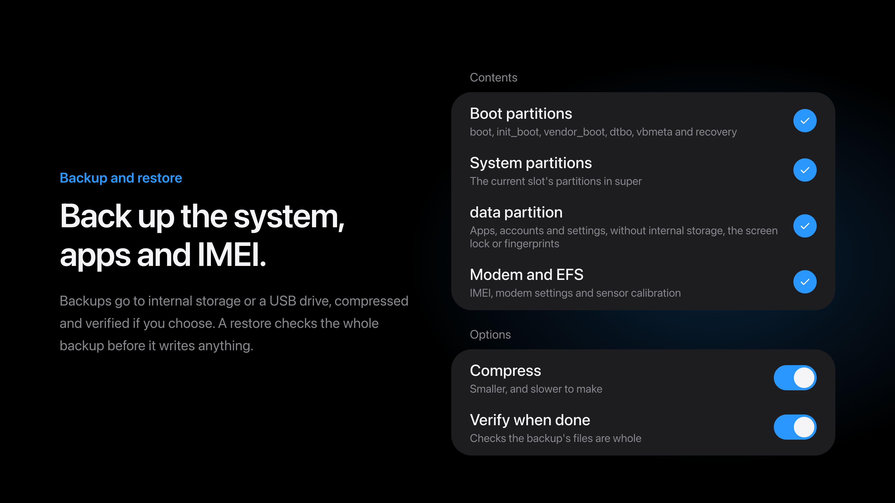

### File manager

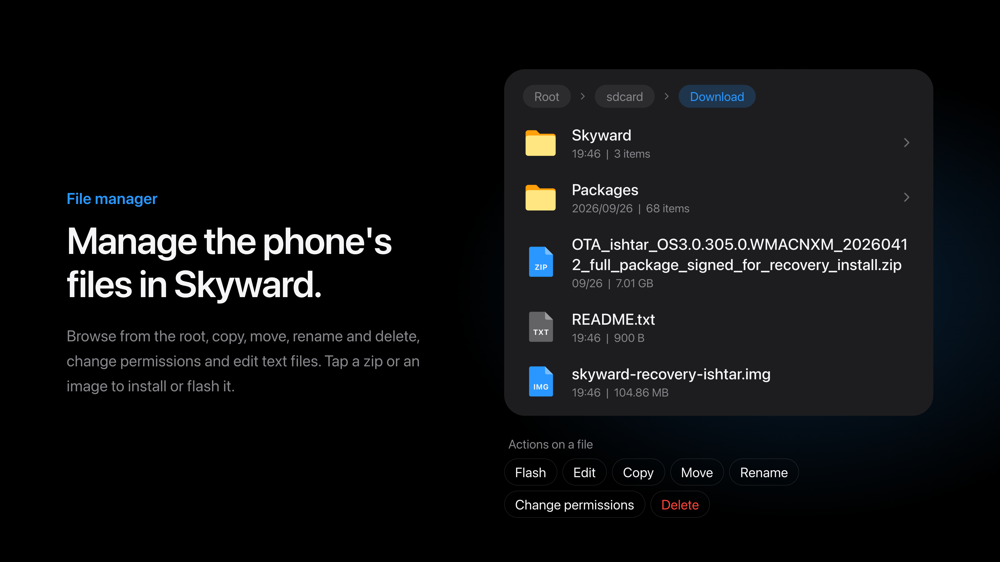

### Terminal

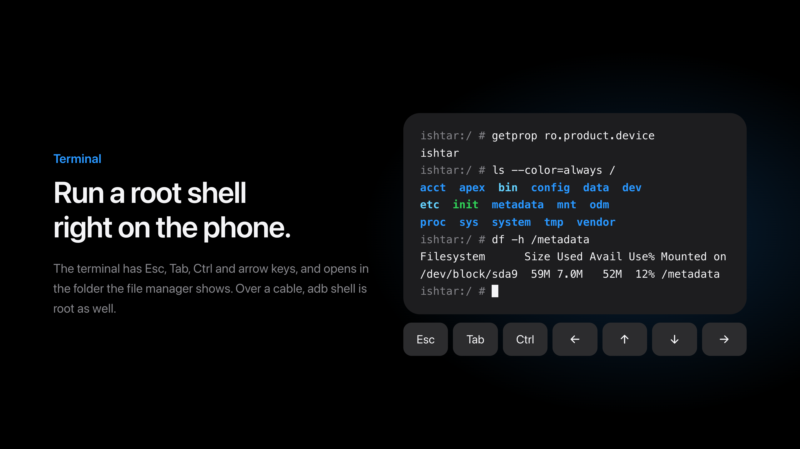

### Connecting a computer

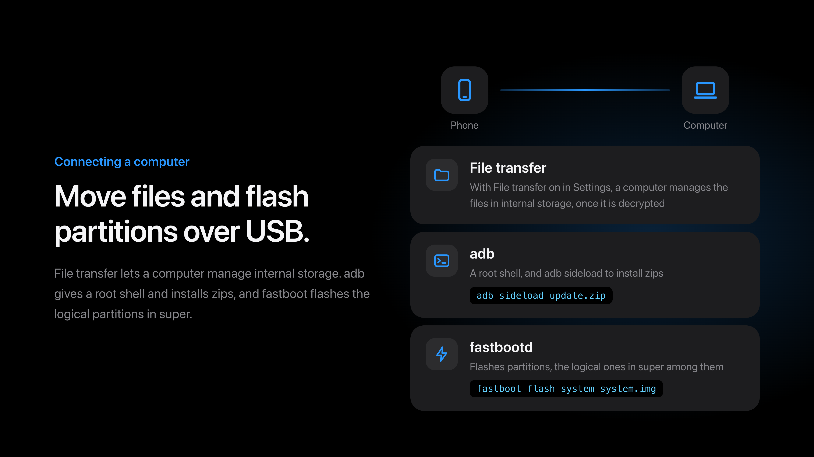

### Wiping data

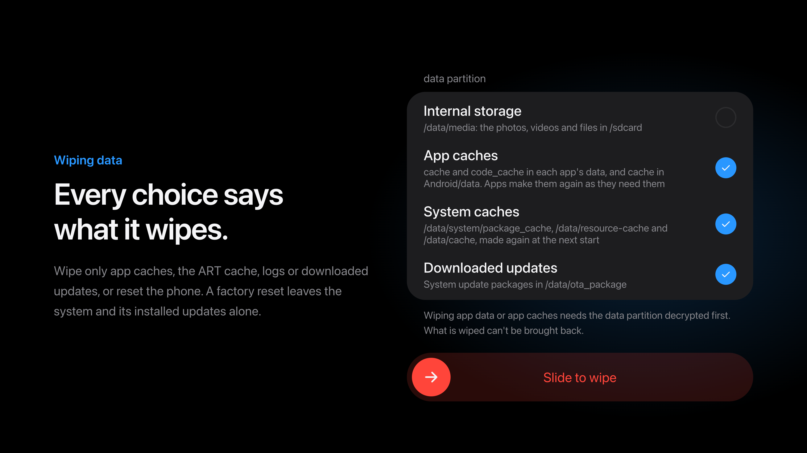

### Replacing the stock recovery

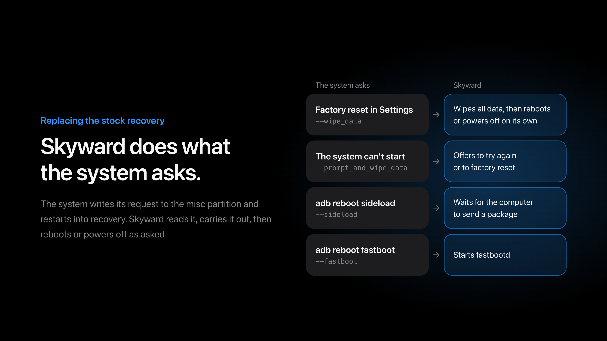

### Search

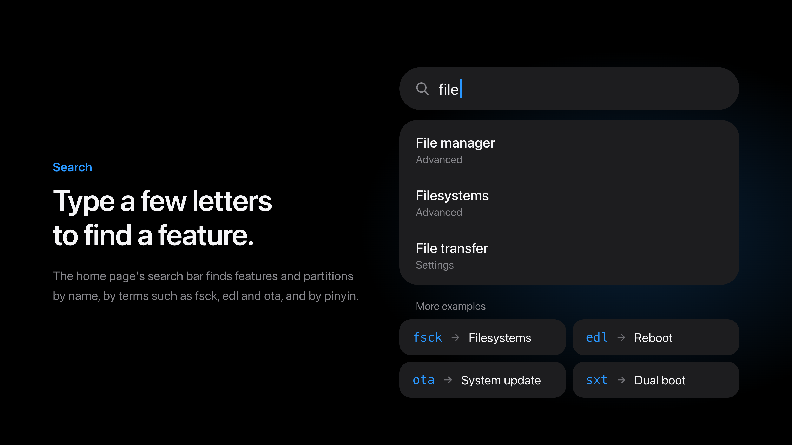

### Advanced

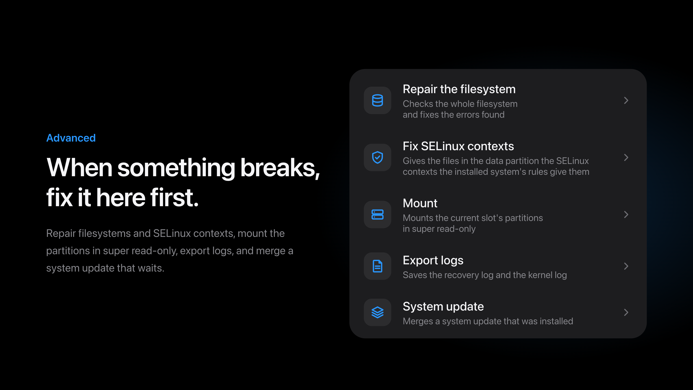

### About phone

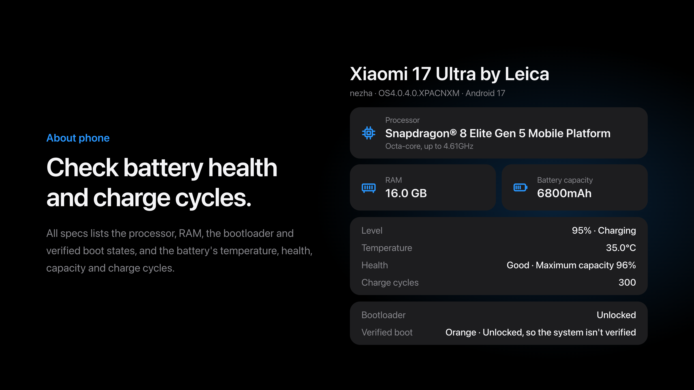

### Other features

- Reboot to system, recovery, fastboot, bootloader or EDL, and switch slots
- Light and dark themes; Simplified Chinese, Traditional Chinese and English

### Without a system

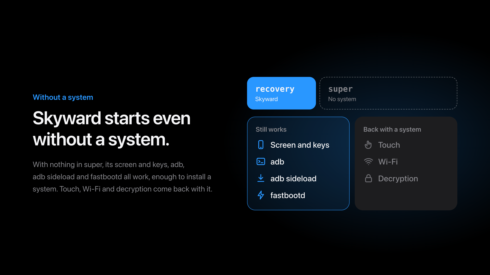

## Supported devices

| Device | Codename | Tested system version |
| --- | --- | --- |
| Xiaomi MIX Flip 2 | `bixi` | OS4.0.11.XOHCNXM (Android 17) |

This fork keeps Skyward for that phone only. The work on it — the cover screen that
comes on when the phone is shut, its touch, and the rest of the bixi changes — is on
`main`, and the images are on
[Releases](https://github.com/XQAB/skyward/releases).

## Installing Skyward

Skyward needs an unlocked bootloader. Download the image for this phone from
[Releases](https://github.com/XQAB/skyward/releases) — the newest one is
`skyward-v1.0.4-bixi-OS4.0.0.11.XOHCNXM.img`, and `0.32.00` was the first version
with the cover panel, `0.37.00` the first one whose cover touch was accepted on
the phone — check it against the SHA-256 in `SHA256SUMS`
(`sha256sum skyward-v1.0.4-bixi-OS4.0.0.11.XOHCNXM.img`), and write it to the recovery
partition of the slot the phone runs from:

```sh
dd if=skyward-v1.0.4-bixi-OS4.0.0.11.XOHCNXM.img of=/dev/block/by-name/recovery_a bs=1048576
```

`fastboot flash recovery` on this phone drops the link partway through a 100MB
image (`Write to device failed (no link)`), so writing it from a root shell — in
Skyward itself, or over `adb` — is the way that holds.

Afterwards Skyward updates itself over Wi-Fi from its newest release, on the
Skyward update page in Settings; a newer image, unzipped, also installs from its own
Install page. With **Flash Skyward again** on, an update or flashable zip installed
here in Skyward that writes over the recovery partitions gets Skyward back in them.
A fastboot flash or the phone's own system updater is not covered, as it runs
without Skyward. The partitions an install has just written are left read-only, so
Skyward clears that flag before every write — 1.0.2 does; 1.0.1 failed with
`Operation not permitted` instead.

adb in Skyward is a root shell that needs no authorization on the phone: anyone
with the phone and a cable can reach its storage while it is in recovery.

## How dual boot works

Skyward installs a second system beside the one in the phone's own partitions,
whether that is HyperOS or a custom ROM, and switches between them from **Dual boot**
on its home page. The second system's root is a file in the data partition that the
filesystem may neither move nor delete, read and written through the partition
itself; the boot images of both systems are kept in another such file. A switch
writes only the boot and init_boot partitions of the slot that starts next, and
keeps each step on /metadata first, so a switch cut off by a loss of power is
finished when Skyward next starts. vendor_boot, dtbo, recovery, vbmeta, the firmware
and super stay as they are, and the second system starts with the installed
system's vendor_boot and dtbo.

Before anything else writes the boot partitions, Skyward puts the installed system's
boot images back: an install, a slot switch, fastboot, a factory reset, and a backup
or restore of the boot partitions. The second system waits while a system update is
still to be merged, and backups of the data partition leave it out.

A second system installs from a zip on the Install page, as any other package does:

| File | What it holds |
| --- | --- |
| `system.toml` | `id`, `name`, `version` and `filesystem`; `init`, the program the root starts with, `/sbin/init` unless given; `minimum`, the least room the root takes, in bytes |
| `boot.img` | The kernel the bootloader starts |
| `rootfs.img` | The root filesystem's image, of the `filesystem` named |
| `init_boot.img` | Only for a system with a first ramdisk of its own |

A system without an init_boot image of its own starts from one Skyward makes. Its
program loads the installed system's first-stage kernel modules the way that
system's first stage loads them, with their soft dependencies and the settings the
kernel command line gives them, finds the root in the data partition, mounts it and
starts `init` there. If anything stops it, it brings Skyward up, as a failed start
of the installed system ends in the recovery: it leaves the reason in misc, unpacks
the ramdisk of the slot's recovery partition over its own, as the kernel unpacks it
when the bootloader starts the recovery, and hands over to Skyward's first program,
so Skyward comes up however the bootloader treats a restart. Skyward shows why, and
the second system still starts next until the user switches on Dual boot. A start
that stops moving restarts into the recovery instead, and a phone restarted before
the hand-over finds the same request in misc at its next start, which brings
Skyward up before anything else. Where Skyward comes up neither way, the phone stays
where it stopped, and never starts the same again and again. A system with a first
ramdisk of its own finds Skyward's program at `/skyward/map`, which lays the root
out as a block device and prints its node. Each switch to the second system writes
its init_boot image with the program of the Skyward that switches, so an updated
Skyward starts it with the new program.

A running system switches by writing `boot-recovery` with
`--switch_system=installed`, or `--switch_system=` and the second system's `id`, to
misc, and restarting into recovery. Where the bootloader starts the slot again, as
the 13 Ultra's can with a USB cable in, Skyward's program finds the request in misc
at the next start and brings Skyward up before anything else.

## Building

Skyward builds with the stable Rust that `rust-toolchain.toml` names, with its
`aarch64-linux-android` target, the Android NDK r29 and
[cargo-ndk](https://github.com/bbqsrc/cargo-ndk). The recovery service is built for
the phone, and the packer for the computer:

```sh
cargo ndk -t arm64-v8a --platform 30 build --release -p skyward
cargo build --release -p skyward-pack
```

The second system's first program runs before any library is there to load, so it
is built as a static program:

```sh
RUSTFLAGS="-C target-feature=+crt-static" cargo ndk -t arm64-v8a --platform 30 build --release -p skyward-system-init --target-dir target/system-init
```

The packer takes the stock recovery partition out of the build's full update
package on Xiaomi's server, reading only the part of the package the partition is
in, and checks its SHA-256 against the device file:

```sh
target/release/skyward-pack stock --config devices/bixi.toml --out target/stock/bixi/recovery.img
```

Then it builds the image on top of it:

```sh
target/release/skyward-pack recovery \
  --stock target/stock/bixi/recovery.img \
  --binary target/aarch64-linux-android/release/skyward \
  --system-init target/system-init/aarch64-linux-android/release/system-init \
  --config devices/bixi.toml \
  --font resources/fonts/MiSansVF.ttf \
  --mono resources/fonts/KirkMono-Regular.ttf \
  --mono-license resources/fonts/KirkMono-OFL.txt \
  --extra bixi_extra \
  --out target/skyward-bixi.img
```

`bixi_extra/` ships with this repository: it holds the secure-element and
weaver pieces the bixi build layers on top of the stock recovery, so a plain
clone builds without a second directory next to it. A phone that needs none of
its own files simply has no `<codename>_extra/`.

What was packed is then read back the way the bootloader and init read it:

```sh
tools/verify-release.py target/skyward-bixi.img \
  --config devices/bixi.toml \
  --extra bixi_extra
```

It takes the image apart itself — the boot header, the LZ4 legacy ramdisk, the
newc archive inside it — and says which pieces are there: every file under
`<codename>_extra/`, the commands a stock recovery lacks as links to
`recovery`, the version the binary says it is, and the stock build
`prop.default` names, against `[stock].version` in the device file. It needs
no tool but Python 3.11 or later, and exits 1 when a check fails. The build runs
it for every device right after packing and keeps the report with the artifacts,
so a build that quietly lost a vendor file fails in CI instead of on the phone.

Tests and lints run on the computer; what runs only on the phone is linted for it:

```sh
cargo test --workspace
cargo clippy --workspace --all-targets -- -D warnings
cargo ndk -t arm64-v8a --platform 30 clippy -p skyward -p skyward-install -p skyward-systems -p skyward-system-init -- -D warnings
```

`skyward-preview` draws the pages on the computer, as PNG files, without a phone:
each page whole, as a long screenshot shows it, in the states it can be in, and the
screen at moments of touches and motion. `--lang` picks the language by a locale
such as `en` or `zh-TW`:

```sh
cargo run --release -p skyward-preview -- target/preview --lang en
```

## License

[GPL-3.0-or-later](LICENSE)
